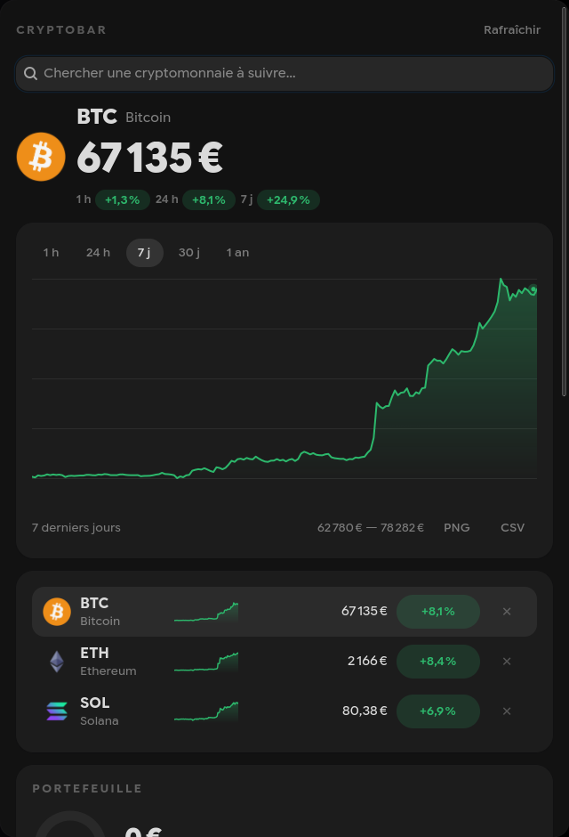

<h1 align="center">cryptobar</h1>

<p align="center">
Crypto prices in your bar, your terminal and your desktop.<br>
No API key, no daemon, no network dependency just to show up.
</p>

<p align="center">

&nbsp;&nbsp;

</p>

```
BTC 66 040 € ▁▁▁▂▂▃▅█ +6.0 %
```

## The four surfaces

| | |
|---|---|
| **Bar** | One cryptocurrency at a time, curve included, scroll to move to the next. Quickshell draws a real curve; Waybar shows a Unicode sparkline. |
| **Panel** | Every watched cryptocurrency, aligned, with the 1 h / 24 h / 7 d changes and the active row highlighted. |
| **Terminal** | `cryptobar chart` — full-resolution braille curve, sized to the actual terminal. |
| **Window** | `cryptobar popup` — GTK4: search, curve over five ranges, watched cryptocurrencies, portfolio, alerts and settings, all editable without opening the configuration file. |

```
BITCOIN  66 346 €   +22.1 %  (7d)

66 876 € │                                                    ⢸⢧⡀  ⢀
         │                                                    ⢸ ⣇⡟⠻⠼
         │                                                  ⣤⡞⢸
         │                                                 ⢀⡇
         │                                        ⡴⣶⠒⠃
         │                                    ⢠⣄⣤⢠⣴⠃
         │                        ⣀⣀⣤⡀ ⣀ ⣀⡞⠓⠲⠴⢦⣀⡀⢀⣀⡤⠇
54 320 € │⠉⠉⠉⠛⠛⠛⠓⠒⠒⠶⠶⠤⠤⠤⠤⠤⠴⠶⠞⠛⠉⠉⠁
```

## Installation

```bash
git clone https://github.com/Akayashuu/cryptobar
cd cryptobar
./install.sh
```

The script builds, installs into `~/.local/bin`, writes the default
configuration and drops the integration examples into `~/.config`. It never
touches your bar configuration: the final wiring is yours to do, and it tells
you exactly what is left.

For a binary with no GTK dependency at all:

```bash
cargo install --path . --no-default-features
```

## Wiring a bar

### Quickshell

```bash
./quickshell/install.sh
qs -c ii kill && qs -c ii -d
```

Widget for the `ii` configuration of dots-hyprland, horizontal bar as well as
vertical. The installer is idempotent and backs up whatever it modifies.
Details, options and manual wiring: [`quickshell/README.md`](quickshell/README.md).

### Waybar

In `~/.config/waybar/config.jsonc`:

```jsonc
"custom/crypto": {
  "exec": "cryptobar bar",
  "return-type": "json",
  "interval": 30,
  "signal": 8,
  "on-click": "cryptobar popup",
  "on-click-right": "cryptobar chart --window",
  "on-click-middle": "cryptobar refresh",
  "on-scroll-up": "cryptobar next",
  "on-scroll-down": "cryptobar prev"
}
```

Then add `"custom/crypto"` to `modules-right` and import the style with
`@import "cryptobar.css";`.

`"signal"` must match `waybar_signal` in the configuration: this is what makes
the scroll update the bar instantly instead of waiting for the next `interval`.

Waybar's `interval` and cryptobar's `refresh_interval` are independent. Waybar
can tick every 5 seconds without issuing a single request: the disk cache
serves the data for as long as it is fresh.

### Ags, Eww, and the rest

`cryptobar bar --markup none` produces the same line without Pango markup. On
top of the already formatted text come separate fields, which Waybar ignores
and which a constrained layout needs — among them `coins`, carrying every
watched cryptocurrency with its series normalised within `[0, 1]`, ready to
plot:

```json
{
  "text": "BTC 65 974 € ▁▁▁▂▂▃▅█ +6.4 %",
  "tooltip": "…",
  "class": "up",
  "symbol": "BTC",
  "price": "65 974 €",
  "percent": "+6.4 %",
  "sparkline": "▁▁▁▂▂▃▅█",
  "trend": "up",
  "stale": false,
  "icon": "~/.cache/cryptobar/icons/bitcoin.png",
  "glyph": "₿", "color": "#f7931a", "foreground": "#101010",
  "coins": [
    {
      "symbol": "BTC", "name": "Bitcoin", "price": "65 974 €",
      "change_1h": "+0.1 %", "change_24h": "+6.4 %", "change_7d": "+22.6 %",
      "trend": "up", "series": [0.0, 0.004, 0.011, "…"], "active": true
    }
  ],
  "alerts": [
    {
      "symbol": "BTC", "kind": "above",
      "title": "BTC above 60 000 €", "body": "Bitcoin is worth 65 974 €."
    }
  ],
  "portfolio": {
    "total": "2 481.60 €", "change_24h": "+148.90 €",
    "change_24h_pct": "+6.4 %", "positive": true,
    "positions": [
      {
        "symbol": "BTC", "quantity": "0.03412",
        "value": "2 290.64 €", "share": 0.923, "color": "#f7931a"
      }
    ]
  }
}
```

`alerts` is empty most of the time: this is what lets a bar light an indicator
up without recomputing anything. `portfolio` is `null` until a watched address
has a balance.

With `--watch`, the process stays in the foreground and re-emits a line on
every interval — a subscription rather than a poll.

## Configuration

`~/.config/cryptobar/config.toml`, created on first run:

```toml
# CoinGecko ids; look them up with `cryptobar coins <term>`.
coins = ["bitcoin", "ethereum", "solana"]

# Quote currency: eur, usd, gbp, chf, cad, jpy, btc, eth
currency = "eur"

# Price refresh interval, in seconds (minimum 15).
refresh_interval = 60

# Automatic rotation between coins, in seconds. 0 = manual scroll only.
cycle_interval = 0

# Inline sparkline in the bar.
sparkline = true
sparkline_width = 8

# Decimals: "auto" adapts to the order of magnitude, or an integer to pin them.
decimals = "auto"

# Terminal emulator opened by the right click.
terminal = "kitty"

# Real-time signal used to refresh Waybar: SIGRTMIN+<n>, 1..=30.
waybar_signal = 8

# Wallets watched read-only — PUBLIC ADDRESSES only.
[[wallets]]
chain = "bitcoin"      # bitcoin, ethereum or solana
address = "bc1q…"
label = "Ledger"

# Price alerts. The three conditions are independent and can be combined.
[[alerts]]
coin = "bitcoin"
above = 100000

[[alerts]]
coin = "ethereum"
change_pct = 5
```

`cryptobar config check` validates the file and explains what is wrong.

## Commands

| Command | Effect |
|---|---|
| `cryptobar bar` | Emits the JSON line Waybar expects |
| `cryptobar bar --markup none` | Same line, without Pango markup |
| `cryptobar bar --watch` | Stays in the foreground and re-emits on every interval |
| `cryptobar next` / `prev` | Changes the displayed cryptocurrency |
| `cryptobar select <N>` | Displays the cryptocurrency at index `N` in the configured list |
| `cryptobar refresh` | Invalidates the cache and wakes the bar up |
| `cryptobar chart [COIN] --range 7d` | Chart in the current terminal |
| `cryptobar chart --window` | Same chart, in a new terminal window |
| `cryptobar popup` | GTK4 window |
| `cryptobar portfolio` | Values the balances of the watched public addresses |
| `cryptobar coins <term>` | Searches for a CoinGecko id |
| `cryptobar config init\|path\|check` | Manages the configuration file |

Ranges accepted by `--range`: `1h`, `24h`, `7d`, `30d`, `1y`.

## Portfolio, read-only

cryptobar can value what you hold without ever being able to touch it. You give
it a **public address** — the one you hand out to *receive* funds, "Receive" in
Ledger Live — and it reads the balance from the chain.

> **cryptobar never asks for, and never accepts, a private key or a recovery
> phrase.** An input containing whitespace (hence a recovery phrase) or
> starting with `xprv` / `yprv` / `zprv` is rejected *before* anything is
> written: the secret never reaches the disk. A test asserts that the
> configuration file stays byte-for-byte identical after such an attempt.

Balances are read from public endpoints, with no API key:
[mempool.space](https://mempool.space) for Bitcoin,
`ethereum-rpc.publicnode.com` for Ethereum, `api.mainnet-beta.solana.com` for
Solana. The addresses and the amounts never leave the machine — no account, no
exchange, no telemetry.

```
$ cryptobar portfolio
BTC    0.03412  2 290.64 €  92.3 %
ETH    0.08820    190.96 €   7.7 %

TOTAL           2 481.60 €
24 h  +148.90 €  (+6.4 %)
```

Add an address from the window ("Watched addresses" section) or straight into
the configuration file.

## Price alerts

Each `[[alerts]]` block watches one cryptocurrency on three independent
conditions that can be combined: `above` and `below` are expressed in the quote
currency, `change_pct` as a 24 h change amplitude.

An alert stays "fired" for as long as its condition holds and re-arms as soon
as it becomes false again: a price oscillating around the threshold only
notifies on crossings, a price that stays above only notifies once.
`cryptobar bar --watch` is what sends the desktop notification; the crossed
alerts also appear in the JSON line and in the window.

## How it stays cheap

The module runs on every tick of the bar, so it cannot afford to be heavy.

- **3 to 5 ms per tick**, measured in release on a warm cache.
- **No daemon** — nothing runs between two ticks. The `--watch` mode exists but
  is not required.
- **No async runtime** — a synchronous HTTP client (`ureq` + `rustls`) is
  enough for one request every 60 seconds and avoids pulling in `tokio`.
- **One request for every cryptocurrency**, 7-day sparklines included.
- **Advisory lock** on the cache: two simultaneous ticks never turn into a
  duplicate request.
- **Atomic writes** for the cache and the state: an interruption has never left
  a half-written file behind.
- **Graceful degradation** — on a network outage the last known data is served
  with the `stale` class rather than leaving a hole in the bar. An exponential
  backoff (60 s → 30 min) avoids hammering the API.
- **Pre-reduced series** — the curve is downsampled and normalised on the
  binary side, rounded to three decimals: the bar only has to plot it.

On the safety side: `unsafe` is forbidden at compile time
(`unsafe_code = "forbid"`), `unwrap`, `expect`, `panic` and direct indexing are
refused by the lints, ids are validated at construction before they can reach a
URL or a path, HTTP redirects are refused, response size is capped at 1 MiB,
and any data coming from the network is escaped before it reaches the Pango
markup.

## Data source

[CoinGecko](https://www.coingecko.com), public API, no key. It rate-limits at
around 10 to 30 requests per minute depending on the load; the minimum
`refresh_interval` of 15 seconds and the cache keep usage far below that limit.

## Development

```bash
cargo test --all-features
cargo clippy --all-targets --all-features -- -D warnings
```

The tests never touch the network: `CRYPTOBAR_API_BASE` redirects the client and
the end-to-end tests pre-fill the cache. `CRYPTOBAR_CONFIG_DIR`,
`CRYPTOBAR_CACHE_DIR` and `CRYPTOBAR_RUNTIME_DIR` isolate the XDG paths.

## License

MIT.
