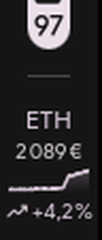

<h1 align="center">cryptobar</h1>

<p align="center">
Les cours crypto dans votre barre, votre terminal et votre bureau.<br>
Sans clé d'API, sans démon, sans dépendance au réseau pour s'afficher.
</p>

<p align="center">

</p>

```
BTC 66 040 € ▁▁▁▂▂▃▅█ +6,0 %
```

## Les quatre surfaces

| | |
|---|---|
| **Barre** | Une cryptomonnaie à la fois, courbe intégrée, molette pour passer à la suivante. Quickshell dessine une vraie courbe ; Waybar affiche une sparkline Unicode. |
| **Panneau** | Toutes les cryptomonnaies suivies, alignées, avec les variations 1 h / 24 h / 7 j et la ligne active mise en avant. |
| **Terminal** | `cryptobar chart` — courbe braille pleine résolution, dimensionnée sur la taille réelle du terminal. |
| **Fenêtre** | `cryptobar popup` — GTK4, prix, variations et courbe vectorielle. |

```
BITCOIN  66 346 €   +22,1 %  (7 j)

66 876 € │                                                    ⢸⢧⡀  ⢀
         │                                                    ⢸ ⣇⡟⠻⠼
         │                                                  ⣤⡞⢸
         │                                                 ⢀⡇
         │                                        ⡴⣶⠒⠃
         │                                    ⢠⣄⣤⢠⣴⠃
         │                        ⣀⣀⣤⡀ ⣀ ⣀⡞⠓⠲⠴⢦⣀⡀⢀⣀⡤⠇
54 320 € │⠉⠉⠉⠛⠛⠛⠓⠒⠒⠶⠶⠤⠤⠤⠤⠤⠴⠶⠞⠛⠉⠉⠁
         └──────────────────────────────────────────────────────────
          15 août                                          21 août
```

## Installation

```bash
git clone https://github.com/Akayashuu/cryptobar
cd cryptobar
./install.sh
```

Le script compile, installe dans `~/.local/bin`, écrit la configuration par
défaut et dépose les exemples d'intégration dans `~/.config`. Il ne touche
jamais à votre configuration de barre : les branchements finaux sont à faire à
la main, il vous les rappelle.

Pour un binaire sans aucune dépendance GTK :

```bash
cargo install --path . --no-default-features
```

## Brancher une barre

### Quickshell

```bash
./quickshell/install.sh
qs -c ii kill && qs -c ii -d
```

Widget pour la configuration `ii` de dots-hyprland, barre horizontale comme
verticale. L'installateur est idempotent et sauvegarde ce qu'il modifie.
Détails, options et câblage manuel : [`quickshell/README.md`](quickshell/README.md).

### Waybar

Dans `~/.config/waybar/config.jsonc` :

```jsonc
"custom/crypto": {
  "exec": "cryptobar bar",
  "return-type": "json",
  "interval": 30,
  "signal": 8,
  "on-click": "cryptobar popup",
  "on-click-right": "cryptobar chart --window",
  "on-click-middle": "cryptobar refresh",
  "on-scroll-up": "cryptobar next",
  "on-scroll-down": "cryptobar prev"
}
```

Puis ajoutez `"custom/crypto"` à `modules-right` et importez le style avec
`@import "cryptobar.css";`.

`"signal"` doit valoir la même chose que `waybar_signal` dans la configuration :
c'est ce qui fait que la molette met la barre à jour instantanément au lieu
d'attendre le prochain `interval`.

L'`interval` de Waybar et le `refresh_interval` de cryptobar sont indépendants.
Waybar peut ticker toutes les 5 secondes sans générer la moindre requête : le
cache disque sert les données tant qu'elles sont fraîches.

### Ags, Eww, et le reste

`cryptobar bar --markup none` produit la même ligne sans balisage Pango. Au
texte déjà mis en forme s'ajoutent des champs séparés, que Waybar ignore et
dont une mise en page contrainte a besoin — dont `coins`, qui porte toutes les
cryptomonnaies suivies avec leur série normalisée dans `[0, 1]`, prête à
tracer :

```json
{
  "text": "BTC 65 974 € ▁▁▁▂▂▃▅█ +6,4 %",
  "tooltip": "…",
  "class": "up",
  "symbol": "BTC",
  "price": "65 974 €",
  "percent": "+6,4 %",
  "sparkline": "▁▁▁▂▂▃▅█",
  "trend": "up",
  "stale": false,
  "coins": [
    {
      "symbol": "BTC", "name": "Bitcoin", "price": "65 974 €",
      "change_1h": "+0,1 %", "change_24h": "+6,4 %", "change_7d": "+22,6 %",
      "trend": "up", "series": [0.0, 0.004, 0.011, "…"], "active": true
    }
  ]
}
```

Avec `--watch`, le processus reste en avant-plan et réémet une ligne à chaque
intervalle — un abonnement, plutôt qu'un sondage.

## Configuration

`~/.config/cryptobar/config.toml`, créé au premier lancement :

```toml
# Identifiants CoinGecko ; cherchez-les avec `cryptobar coins <terme>`.
coins = ["bitcoin", "ethereum", "solana"]

# Devise de cotation : eur, usd, gbp, chf, cad, jpy, btc, eth
currency = "eur"

# Intervalle de rafraîchissement des prix, en secondes (minimum 15).
refresh_interval = 60

# Rotation automatique entre les coins, en secondes. 0 = rotation manuelle à la molette.
cycle_interval = 0

# Sparkline inline dans la barre.
sparkline = true
sparkline_width = 8

# Décimales : "auto" s'adapte à l'ordre de grandeur, ou un entier pour les figer.
decimals = "auto"

# Émulateur de terminal utilisé par le clic droit.
terminal = "kitty"

# Signal temps réel utilisé pour rafraîchir Waybar : SIGRTMIN+<n>, 1..=30.
waybar_signal = 8
```

`cryptobar config check` valide le fichier et explique ce qui cloche.

## Commandes

| Commande | Effet |
|---|---|
| `cryptobar bar` | Émet la ligne JSON attendue par Waybar |
| `cryptobar bar --markup none` | Même ligne, sans balisage Pango |
| `cryptobar bar --watch` | Reste en avant-plan et réémet à chaque intervalle |
| `cryptobar next` / `prev` | Change la cryptomonnaie affichée |
| `cryptobar refresh` | Invalide le cache et réveille la barre |
| `cryptobar chart [COIN] --range 7d` | Graphique dans le terminal courant |
| `cryptobar chart --window` | Même graphique, nouvelle fenêtre de terminal |
| `cryptobar popup` | Fenêtre GTK4 |
| `cryptobar coins <terme>` | Cherche un identifiant CoinGecko |
| `cryptobar config init\|path\|check` | Gère le fichier de configuration |

Plages acceptées par `--range` : `1h`, `24h`, `7d`, `30d`, `1y`.

## Comment ça tient en ressources

Le module s'exécute à chaque tick de la barre, il ne peut donc pas se permettre
d'être lourd.

- **3 à 5 ms par tick**, mesuré en release sur cache chaud.
- **Pas de démon** — rien ne tourne entre deux ticks. Le mode `--watch` existe
  mais n'est pas nécessaire.
- **Pas de runtime asynchrone** — un client HTTP synchrone (`ureq` + `rustls`)
  suffit pour une requête toutes les 60 secondes et évite d'embarquer `tokio`.
- **Une requête pour toutes les cryptomonnaies**, sparklines 7 jours comprises.
- **Verrou consultatif** sur le cache : deux ticks simultanés ne partent jamais
  en double requête.
- **Écriture atomique** du cache et de l'état : une coupure n'a jamais laissé de
  fichier à moitié écrit.
- **Repli progressif** — en cas de panne réseau, les dernières données connues
  sont servies avec la classe `stale` plutôt que de laisser un trou dans la
  barre. Un backoff exponentiel (60 s → 30 min) évite de marteler l'API.
- **Séries pré-réduites** — la courbe est sous-échantillonnée et normalisée
  côté binaire, arrondie à trois décimales : la barre n'a plus qu'à tracer.

Côté sûreté : `unsafe` est interdit à la compilation (`unsafe_code = "forbid"`),
`unwrap`, `expect`, `panic` et l'indexation directe sont refusés par les lints,
les identifiants sont validés à la construction avant de pouvoir atteindre une
URL ou un chemin, les redirections HTTP sont refusées, la taille des réponses
est plafonnée à 1 Mio, et toute donnée venant du réseau est échappée avant
d'atteindre le balisage Pango.

## Source des données

[CoinGecko](https://www.coingecko.com), API publique, sans clé. Elle limite le
débit aux alentours de 10 à 30 requêtes par minute selon la charge ; le
`refresh_interval` minimum de 15 secondes et le cache gardent l'usage très en
dessous de cette limite.

## Développement

```bash
cargo test --all-features
cargo clippy --all-targets --all-features -- -D warnings
```

Les tests ne touchent jamais le réseau : `CRYPTOBAR_API_BASE` redirige le client
et les tests bout en bout pré-remplissent le cache. `CRYPTOBAR_CONFIG_DIR`,
`CRYPTOBAR_CACHE_DIR` et `CRYPTOBAR_RUNTIME_DIR` isolent les chemins XDG.

## Licence

MIT.
